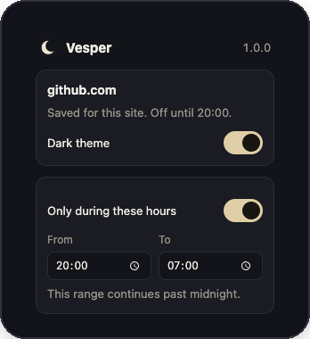

  

  <a href="#private-by-design">Private</a>
  &nbsp;&nbsp;·&nbsp;&nbsp;
  <a href="#install">Install</a>
  &nbsp;&nbsp;·&nbsp;&nbsp;
  <a href="#use">Use</a>
  &nbsp;&nbsp;·&nbsp;&nbsp;
  <a href="#theme">Theme</a>
  &nbsp;&nbsp;·&nbsp;&nbsp;
  <a href="LICENSE">MIT</a>

  Vesper runs on your computer. It has no server, no account, and no network requests. 
  The sites you turn on, and the hours you pick, stay in this browser.

  

  On for github.com, and only from 20:00 to 07:00.

<table>
  <tr>
    <td width="33%" valign="top">
      <strong>Per site</strong> 
      Each hostname stays light until you turn Vesper on for it. The choice is remembered on this profile.
    </td>
    <td width="33%" valign="top">
      <strong>By the hour</strong> 
      An optional range can cross midnight. <code>20:00</code> to <code>07:00</code> stays on through the night and off after <code>07:00</code>.
    </td>
    <td width="33%" valign="top">
      <strong>Nothing leaves</strong> 
      No analytics and no remote code. The content script only adds or removes a CSS class.
    </td>
  </tr>
</table>

## Private by design

Vesper does not send browsing data, page text, passwords, or cookies anywhere. There is no phone-home, no telemetry, and no account to sign into.

| | |
| --- | --- |
| Where it runs | In your browser, from a folder on your machine. |
| What it stores | Enabled hostnames and the hour range, in `chrome.storage.local` on this profile. |
| What it does to a page | Adds or removes one CSS class. It does not read the page. |
| What it does not do | Make a network request, sync through your Google account, or install itself on your other computers. |

Loading it unpacked is what keeps it local. Chrome syncs extensions from the Chrome Web Store. It does not sync an extension you load from a folder, even when the same Google account is signed in on another machine. Publishing this repository does not install Vesper.

## Install

1. Clone this repository.
2. Open `chrome://extensions`.
3. Turn on **Developer mode**.
4. Click **Load unpacked** and select the cloned folder.

Chrome reads the files from that folder, so leave the checkout where it is. After pulling changes, click **Reload** on the Vesper card, then refresh open tabs.

## Use

Open the popup on an `http` or `https` page.

- **Dark theme** stores that hostname. Other sites stay unchanged.
- **Only during these hours** limits every enabled site to the range you set. The site switch stays on. The theme waits until the clock is inside the range.
- The same start and end time covers the whole day.
- The version in the popup is the `version` in `manifest.json`.

The content script checks the clock about every 15 seconds, and again when you return to the tab. An open page updates when the range starts or ends.

`chrome://` pages and the Chrome Web Store cannot be themed.

## Theme

Enabled pages get `filter: invert(1) hue-rotate(180deg)`. Images, video, canvas, embeds, and objects are inverted again so their colors stay closer to the original.

Pages that are already dark, or that use photographs as CSS backgrounds, can look wrong. Vesper does not inspect a page's palette.

## Permissions

| Permission | Purpose |
| --- | --- |
| `storage` | Stores enabled hostnames and the hour range in this profile. |
| `activeTab` | Reads the current tab's address when the popup opens. |
| Content script on all URLs | Injects the stylesheet. The dark class is added only for a hostname you enabled, and only inside the hour range when that range is on. |

Those permissions stay on the computer. `storage` is local. `activeTab` is used only to show the open site in the popup. The content script does not upload what it can see.

## Version

The version is the `version` field in `manifest.json`. The popup shows that same number. The current version is **1.0.0**.

| Version | What changed |
| --- | --- |
| 1.0.0 | First public version. Per-site dark theme, optional hour range, local storage only. |

Bump that number when the behavior changes: the last digit for a fix, the middle digit for a new feature. Git history is the full record. A separate release tool is not required.

## Development

There is no build step. Edit the files and reload the extension. If the behavior changed, bump `version` in `manifest.json` before sharing the update.

| File | Role |
| --- | --- |
| `manifest.json` | Name, version, permissions |
| `popup.html`, `popup.css`, `popup.js` | Popup |
| `content.js` | Applies and removes the theme |
| `schedule.js` | Hour-range check used by the popup and the content script |
| `dark.css` | Invert filter |
| `icons/` | Toolbar and popup icon |
| `docs/` | Images used in this README |

## License

[MIT](LICENSE) © 2026 Hossein Mousavi
